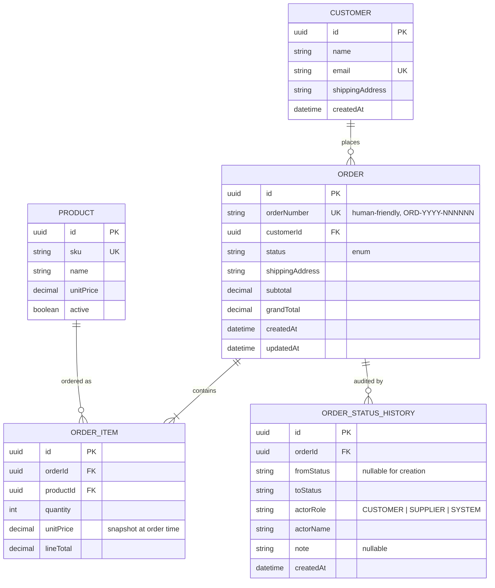

# Development Plan — B2B Order Management & Logistics POC

Companion to [README.md](./README.md) (extracted assessment spec). This file is the working plan: phases, deliverables, decisions, and a checklist to track progress.

**Guiding rule from the brief:** a smaller, correct, well-explained solution beats a larger, fragile one. Every phase ends in something demoable.

---

## 0. Stack & Scope Decisions (lock before coding)

| Area       | Decision                                                                                          | Why                                                              |
| ---------- | ------------------------------------------------------------------------------------------------- | ---------------------------------------------------------------- |
| Framework  | Next.js 16 (App Router) + TypeScript                                                              | One codebase for UI + API routes, spec-sanctioned                |
| DB         | PostgreSQL 16 via `docker compose`                                                                | Spec-preferred; reproducible for reviewers                       |
| ORM        | Prisma 7 + `prisma migrate`                                                                       | Versioned migrations, type-safe queries, fast to build           |
| Validation | Zod on every route handler (body, query, params)                                                  | Spec requirement; single source for types                        |
| Styling    | Tailwind CSS + small local component set                                                          | Fast, no heavy UI lib, consistent                                |
| PDF        | `@react-pdf/renderer` server-side                                                                 | JSX templates, no headless browser in Docker; fallback: `pdfkit` |
| Auth       | Mock session: signed JWT (`jose`) in `httpOnly` cookie, role + mock customer id                   | Enforced server-side, not just hidden UI                         |
| API style  | REST-ish Next route handlers, JSON envelope `{ data }` / `{ error: { code, message, details? } }` | Predictable, easy to defend                                      |
| Tests      | Vitest (state machine + validation) + a few route/integration tests                               | Honest coverage, not vanity coverage                             |
| Pagination | Server-side (`page`, `pageSize=10`)                                                               | Spec-preferred; demonstrates query design                        |
| Time       | Store UTC `timestamptz`; render in one fixed timezone                                             | Avoid date-range off-by-one bugs                                 |

**Explicitly out of scope:** real identity provider, email, payments, inventory reservation, multi-tenant supplier support, websockets. State these in README "Known gaps".

**Assumptions to document in README:** single supplier; static product catalog; one mock customer (plus maybe 2 for RBAC tests); invoice number = `INV-<orderNumber>`; currency fixed (e.g. USD); date filters interpreted in UTC.

---

## 1. Target Architecture

```
Browser (React Server + Client Components)
  │  fetch / form actions
  ▼
Next.js Route Handlers (/app/api/**)
  │  Zod parse → session/RBAC guard → service layer → Prisma
  ▼
PostgreSQL (docker compose)
```

Layers:

- `lib/schemas/*` — Zod input schemas + inferred types
- `lib/auth/*` — session cookie issue/verify, `requireRole`, `requireCustomerOwnsOrder`
- `lib/orders/state-machine.ts` — allowed transitions, terminal states, filter-label mapping
- `lib/orders/service.ts` — create, list, transition (transactional), history
- `lib/pdf/invoice.tsx` — invoice document + render pipeline
- `app/api/**` — thin handlers: parse → authorize → call service → map errors
- `app/(customer)/**`, `app/(supplier)/**` — role-scoped pages

### ER model (target)



Indexes to create and defend:

- `order(status, createdAt)` — dashboard filter + sort
- `order(customerId, createdAt)` — customer order list
- `order(orderNumber)` unique — search/track/invoice lookup
- `order_status_history(orderId, createdAt)` — timeline
- Customer name search: `pg_trgm` GIN on `customer.name` (or `lower(name)`) + join; document the choice
- Consider composite `(status, createdAt DESC)` for paginated filter

Order number generation: Postgres sequence padded to 6 digits (`ORD-2026-000042`); internal PK stays UUID. Generate inside the same transaction as order creation.

### Status machine

```
PENDING_SUPPLIER_APPROVAL → ACCEPTED | REJECTED
ACCEPTED                  → DISPATCHED
DISPATCHED                → IN_TRANSIT
IN_TRANSIT                → DELIVERED
REJECTED, DELIVERED       → terminal
```

- Single source of truth in `state-machine.ts` (map + `canTransition`).
- Filter label `PENDING` → stored `PENDING_SUPPLIER_APPROVAL`; map at the query boundary, document in README.
- Transition = one `prisma.$transaction`: conditional update (`where { id, status: expected }`) + insert history. If count = 0 → `409 ILLEGAL_TRANSITION` / `409 CONFLICT`. This also handles concurrent double-clicks.
- History is append-only: no update/delete routes; enforce by never exposing them.

---

## 2. API Surface (target)

| Method | Path                                              | Role                      | Purpose                                                        |
| ------ | ------------------------------------------------- | ------------------------- | -------------------------------------------------------------- |
| POST   | `/api/auth/login`                                 | public                    | `{ role, customerId? }` → set session cookie                   |
| POST   | `/api/auth/logout`                                | any                       | Clear cookie                                                   |
| GET    | `/api/auth/session`                               | any                       | Current role + customer                                        |
| GET    | `/api/products`                                   | customer                  | Mock catalog (8+)                                              |
| POST   | `/api/orders`                                     | customer                  | Create order → `PENDING_SUPPLIER_APPROVAL`                     |
| GET    | `/api/orders`                                     | customer                  | Own orders (simple list)                                       |
| GET    | `/api/orders/[orderNumber]`                       | customer (own) / supplier | Detail + items + history                                       |
| GET    | `/api/orders/[orderNumber]/invoice`               | customer (own) / supplier | PDF, only if status ∈ ACCEPTED/DISPATCHED/IN_TRANSIT/DELIVERED |
| GET    | `/api/supplier/orders?q=&status=&from=&to=&page=` | supplier                  | Paginated dashboard query                                      |
| POST   | `/api/orders/[orderNumber]/transitions`           | supplier                  | `{ toStatus, note? }`, validated against map                   |

Notes:

- Invoice role: spec says customer downloads; supplier read access acceptable — restrict customers to own orders.
- `400` validation, `401` no session, `403` wrong role/not owner, `404` missing, `409` illegal transition, `500` unexpected.
- Every handler parses params/query/body with Zod before touching the DB.

---

## 3. Phases

### Phase 0 — Project foundation (0.5 day) ✅ COMPLETE

**Goal:** `docker compose up` + `npm run dev` gives a running app with DB and empty pages.

- [x] Init Next.js 16 + TS + Tailwind + ESLint/Prettier
- [x] `docker-compose.yml` with Postgres 16, healthcheck, named volume
- [x] `.env.example` (`DATABASE_URL`, `SESSION_SECRET`, `APP_TIMEZONE`, `CURRENCY`)
- [x] Prisma init, datasource + `prisma migrate dev` workflow documented
- [x] Base layout, nav shell, `/login` placeholder, `not-found`, error boundary
- [x] npm scripts: `dev`, `build`, `lint`, `typecheck`, `test`, `db:migrate`, `db:seed`, `db:reset`
- [x] Initial commit with meaningful message

**Done when:** fresh clone can boot per README, migrations run clean, `npm run build` passes.

### Phase 1 — Data model & migrations (0.5 day)

**Goal:** complete schema, one migration, referential integrity.

- [ ] Enums: `OrderStatus`, `ActorRole`
- [ ] Models: `Customer`, `Product`, `Order`, `OrderItem`, `OrderStatusHistory`
- [ ] Money as `Decimal(10,2)`; timestamps `@db.Timestamptz`
- [ ] Order `orderNumber` unique; sequence for generation
- [ ] Indexes from architecture section (incl. trigram extension + migration note)
- [ ] Seed catalog: 8+ products with realistic names/prices
- [ ] Seed 2 customers
- [ ] `prisma migrate dev` → commit migration SQL; verify `prisma migrate reset` works
- [ ] Sanity queries for search/filter/sort with `EXPLAIN` (note results in README)

**Done when:** reset → migrate → seed is deterministic and idempotent-safe.

### Phase 2 — Seed data for filters/pagination (0.5 day)

**Goal:** ≥30 orders across all statuses and varied dates; audit trails consistent.

- [ ] Seed script: ≥30 orders, spread over ~90 days, all 6 filter statuses, varied customers
- [ ] Every seeded order has a coherent history chain ending in its current status
- [ ] 1–2 rejected orders and 2–3 delivered orders for stepper/terminal demos
- [ ] Deterministic seed (fixed random seed or hardcoded offsets) so screenshots/demos are stable
- [ ] Guard: refuse to run in production; optional `--force` truncate
- [ ] Log summary counts per status

**Done when:** dashboard pagination shows ≥3 pages; each filter returns non-empty results; every order's timeline matches its status.

### Phase 3 — Auth mock + RBAC (0.5 day)

**Goal:** role is server-enforced; UI reflects it.

- [ ] `/login` with Customer/Supplier toggle, mock customer selector
- [ ] Sign JWT with `role` + `customerId`, `httpOnly`, `sameSite=lax`, expiry
- [ ] `getSession()` / `requireRole()` / `requireCustomerOwnership()` helpers
- [ ] Reject missing/invalid cookie with `401`; wrong role with `403`
- [ ] Route-level protection for page groups + redirect to `/login`
- [ ] Tests: customer calling supplier transition API → `403`; supplier creating order → `403`; customer reading another customer's order → `403`/`404` (decide and document)

**Done when:** curl with each role proves server-side enforcement (not just hidden buttons).

### Phase 4 — Customer: catalog, order creation, invoice (1.5 days)

**Goal:** end-to-end order placement with validated totals and server-side PDF.

- [ ] Catalog page from `GET /api/products`
- [ ] Order form: quantities per product, shipping address, customer details prefilled; client-side hints only
- [ ] `createOrderSchema`: ≥1 item, qty ≥ 1, known product IDs, address non-empty, no duplicate lines
- [ ] Server re-prices from DB (never trust client prices), computes `lineTotal`, `subtotal`, `grandTotal`
- [ ] Create order + items + initial history (`SYSTEM`/customer) in one transaction
- [ ] Order confirmation page + customer order list with status badges
- [ ] Invoice route: RBAC + ownership + status gate → `@react-pdf/renderer` stream with `Content-Disposition: attachment`
- [ ] PDF content check: order ID, invoice number, lines, totals, customer name, address, issue date, currency formatting, page-safe layout
- [ ] Hide/disable Download Invoice unless status ∈ ACCEPTED…DELIVERED; still enforce server-side (403/409)
- [ ] Tests: total computation, invoice eligibility matrix, PDF returns `application/pdf`

**Done when:** place order → supplier accepts → customer downloads a correct PDF; pre-acceptance request returns an error.

### Phase 5 — Supplier dashboard (1.5 days)

**Goal:** spec-complete search/filter/pagination, all URL-driven.

- [ ] `GET /api/supplier/orders` with Zod-validated `q`, `status`, `from`, `to`, `page`
- [ ] Partial case-insensitive search on order number + customer name (`contains`, `mode: insensitive`)
- [ ] Status filter incl. `PENDING` → `PENDING_SUPPLIER_APPROVAL` mapping
- [ ] Inclusive date range (start 00:00:00, end 23:59:59.999 UTC; document timezone)
- [ ] Combined filters + server pagination: `count` + `take/skip` in one transaction, `pageSize=10`
- [ ] URL as state: `?q=&status=&from=&to=&page=`; refresh/share restores view; invalid params fall back safely
- [ ] Table UI: order number, customer, date, total, status badge, actions
- [ ] Total count + page controls (prev/next, numbered or compact); reset page to 1 when filters change
- [ ] Row actions per role/status: Accept/Reject on PENDING; Dispatch/In Transit/Delivered stepwise
- [ ] Optimistic-ish feedback via revalidation; disable buttons during request; surface API errors
- [ ] Empty state, loading state, error state
- [ ] Tests: filter combination query builder, PENDING mapping, page math, date boundary cases

**Done when:** every filter combo is shareable, pagination math is correct with 30+ rows, illegal actions are impossible or rejected cleanly.

### Phase 6 — Logistics tracking + audit trail (1 day)

**Goal:** customer tracking view with honest terminal handling.

- [ ] `/track` with Order ID input (customer-scoped; supplier can view any)
- [ ] Stepper: Placed → Accepted → Dispatched → In Transit → Delivered, driven by history/status
- [ ] Rejected: distinct terminated state (not a stalled stepper), with rejection timestamp/role
- [ ] Timeline: from → to, timestamp formatted `Nov 11, 2026, 14:00`, actor role/name, optional note
- [ ] Order detail page reuses tracking component
- [ ] Supplier order detail page shows same history + action buttons
- [ ] History ordering deterministic (createdAt, id tiebreak)
- [ ] Tests: stepper derivation per status, rejected variant, history serialization

**Done when:** demo can walk a fresh order through all states and show a truthful timeline; rejected order clearly terminal.

### Phase 7 — Hardening (0.5–1 day)

- [ ] Central error mapper → consistent `{ error: { code, message, details } }`
- [ ] Zod error formatting to field-level details
- [ ] Ownership checks audited on every order-scoped route
- [ ] Transaction + conditional update verified under double-submit (manual/curl test)
- [ ] No secrets in repo; `.env.example` complete; `.gitignore` covers `.env*`
- [ ] `npm run lint`, `typecheck`, `test`, `build` all green
- [ ] Fresh-machine run-through: clone → env → compose → migrate → seed → dev
- [ ] Optional: Playwright happy path (login → order → accept → invoice → track)

**Done when:** reviewer can follow README verbatim without asking questions.

### Phase 8 — Documentation & defence prep (1 day, overlaps 7)

- [ ] README sections: setup/run, seed, architecture, ER Mermaid, API summary, decisions/trade-offs, known gaps, next steps, assumptions
- [ ] Document: PENDING mapping, server pagination choice, order number scheme, money/rounding, UTC dates, trigram search, invoice eligibility, concurrency handling
- [ ] `AI_USAGE.md`: tools, tasks, 2–3 winning prompts, one wrong-output story with detection/fix
- [ ] Optional 3–5 min recording script (storyboard: login → order → accept → dispatch → track → invoice → filters)
- [ ] Commit history clean-up: logical commits, no WIP noise (do not rewrite others' work; repo is ours)
- [ ] Prepare defence notes: why Prisma, why cookie JWT, why server pagination, where race conditions live, what I'd change at scale
- [ ] Dry-run demo twice, timed; have seeded data reset command ready
- [ ] Repository access confirmed for reviewers before deadline

**Done when:** README alone lets a reviewer run and understand the app; demo runs clean in under 5 minutes.

---

## 4. Suggested Timeline

| Day | Phases  | Milestone                               |
| --- | ------- | --------------------------------------- |
| 1   | 0, 1, 2 | Bootable app, schema, 30+ seeded orders |
| 2   | 3, 4    | RBAC proven; order + invoice flow works |
| 3   | 5       | Dashboard spec-complete                 |
| 4   | 6, 7    | Tracking + hardening, tests green       |
| 5   | 8       | Docs, AI_USAGE, demo rehearsal, buffer  |

Estimates assume one developer with AI assistance. If time compresses, cut optional recording and Playwright before cutting tests or docs.

---

## 5. Risks & Mitigations

| Risk                                      | Mitigation                                                                                |
| ----------------------------------------- | ----------------------------------------------------------------------------------------- |
| Date filter off-by-one / timezone drift   | Store timestamptz, parse dates as UTC bounds, test boundary cases (inclusive end)         |
| Double transition / race on accept        | Conditional update `where status=expected` inside transaction; assert affected rows       |
| Invoice leak before acceptance            | Server-side status gate + ownership check; UI hiding is cosmetic only                     |
| Role spoofing by editing cookie           | Signed JWT + `httpOnly`; never trust client-sent role                                     |
| PDF fonts/currency rendering              | Embed standard font, ASCII-safe currency code; smoke-test PDF bytes and open output       |
| Slow search with 30 rows (masked by size) | Add trigram/btree indexes anyway, verify with `EXPLAIN`, document intent                  |
| Scope creep (real auth, emails, S3)       | Park in "Known gaps"; deliver spec first                                                  |
| Reviewer cannot run app                   | Docker compose + one-command seed + README test on clean machine                          |
| AI-generated code I cannot defend         | Review every file, write the state machine + validation by hand, keep notes for interview |

---

## 6. Definition of Done (assessment-level)

- [ ] All functional requirements from README implemented and demoable
- [ ] Role enforcement verified via API, not UI only
- [ ] All transitions validated, terminal states enforced, audit trail immutable and transactional
- [ ] Server-side search + combined filters + URL state + 10/page pagination with total count
- [ ] Invoice PDF correct and gated by status/ownership
- [ ] Stepper incl. distinct rejected/terminated state; timeline shows timestamps and roles
- [ ] 30+ seeded orders across all statuses and dates
- [ ] ER diagram, API summary, decisions, gaps, assumptions documented
- [ ] `AI_USAGE.md` complete and honest
- [ ] Clean clone boots with documented commands; `.env.example`; no secrets
- [ ] Repo URL + reviewer access submitted before deadline; demo rehearsed

---

## 7. Optional Stretch (only after DoD)

- [ ] Order cancellation before acceptance (new transition + tests)
- [ ] CSV export of filtered dashboard
- [ ] Supplier notes on transitions surfaced in timeline
- [ ] Optimistic UI with `useOptimistic`
- [ ] Playwright end-to-end suite in CI
- [ ] Rate limiting on login/invoice routes
