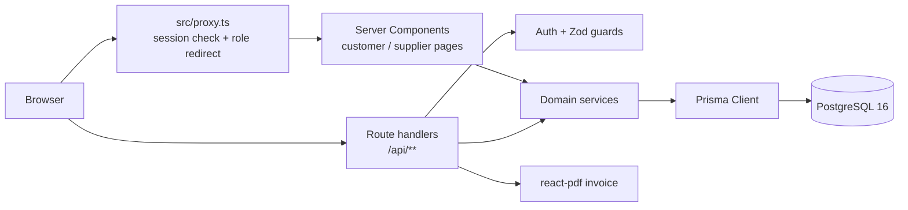
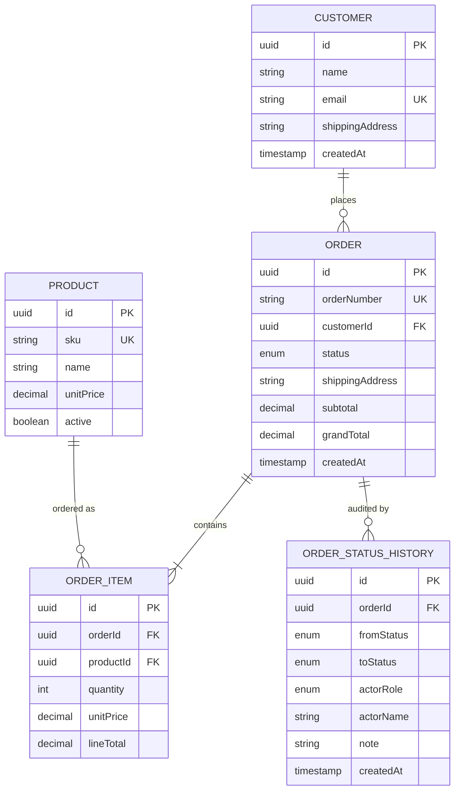

# Order Management & Logistics POC

Full-stack proof of concept for B2B ordering: customers place orders, track deliveries, and
download invoices; suppliers approve orders and progress them through logistics, with every status
change audited.

Built with Next.js (App Router), TypeScript, PostgreSQL, Prisma, Zod, and Tailwind CSS.

Status: **POC complete** — customer ordering and PDF invoices, supplier dashboard with filters and
pagination, audited logistics tracking, and server-enforced role access. See [PLAN.md](./PLAN.md)
for the phased roadmap, [DEMO.md](./DEMO.md) for a walkthrough, and
[AI_USAGE.md](./AI_USAGE.md) for how AI tools were used.

## Getting Started

### Prerequisites

- Node.js 20.9+ and npm
- Docker Desktop (for the PostgreSQL container)
- Git

### 1. Install dependencies

```bash
npm install
```

`postinstall` runs `prisma generate`, so the Prisma Client is created automatically.

### 2. Configure environment

```bash
cp .env.example .env
```

Generate a session secret and paste it into `.env`:

```bash
node -e "console.log(require('crypto').randomBytes(32).toString('hex'))"
```

Never commit `.env`; it is ignored by Git. `.env.example` documents every variable.

### 3. Start PostgreSQL

```bash
docker compose up -d
docker compose ps
```

The database listens on `localhost:5432` with the development credentials defined in
`docker-compose.yml` (user/password/database: `assessment`). Data persists in the
`postgres_data` volume.

### 4. Apply database migrations

```bash
npm run db:migrate    # creates/applies a migration during development
```

The first migration is added in Phase 1 together with the data model. To reset local data later:

```bash
npm run db:reset      # drops, recreates, migrates, and seeds the database
```

### 5. Run the app

```bash
npm run dev
```

Open <http://localhost:3000>.

### Available scripts

| Command              | Purpose                                             |
| -------------------- | --------------------------------------------------- |
| `npm run dev`        | Start the development server                        |
| `npm run build`      | Production build                                    |
| `npm run start`      | Serve the production build                          |
| `npm run lint`       | ESLint (Next.js core-web-vitals + TypeScript rules) |
| `npm run typecheck`  | TypeScript with no emit                             |
| `npm run test`       | Vitest unit tests                                   |
| `npm run verify`     | Lint + typecheck + tests in one command             |
| `npm run format`     | Prettier (includes Tailwind class sorting)          |
| `npm run db:migrate` | Create and apply a development migration            |
| `npm run db:deploy`  | Apply committed migrations (CI/production)          |
| `npm run db:seed`    | Seed the database                                   |
| `npm run db:reset`   | Reset the database and re-run seed data             |
| `npm run db:studio`  | Open Prisma Studio                                  |

### Project structure

```text
.
├── prisma/
│   ├── schema.prisma        # Data model
│   ├── seed.ts              # Deterministic catalog, customers, 36 orders
│   └── migrations/          # Versioned SQL migrations (committed)
├── src/
│   ├── app/
│   │   ├── api/             # Auth, products, orders, invoices, supplier list, transitions
│   │   ├── customer/        # Order list, new order, detail, tracking (role-guarded)
│   │   ├── supplier/        # Dashboard and order detail (role-guarded)
│   │   ├── login/           # Mock sign-in
│   │   └── layout.tsx       # App shell
│   ├── proxy.ts             # Session + role protection before render
│   ├── components/
│   │   ├── auth/            # Login form
│   │   ├── layout/          # Header and footer
│   │   ├── orders/          # Badges, stepper, timeline, order form
│   │   └── supplier/        # Filters, pagination, row actions
│   ├── config/              # Static app configuration
│   ├── lib/
│   │   ├── api/             # Error envelope helpers
│   │   ├── auth/            # Session, guards, authorization, mock login
│   │   ├── db/              # Prisma client factory and server singleton
│   │   └── orders/          # Schema, pricing, state machine, queries, PDF
│   └── generated/prisma/    # Generated Prisma Client (not committed)
├── tests/
│   ├── api/                 # Error envelope tests
│   ├── auth/                # Session, RBAC, login schema
│   └── orders/              # Pricing, status, filters, pagination, tracking
├── docker-compose.yml       # Local PostgreSQL 16
├── prisma.config.ts         # Prisma CLI configuration
├── AI_USAGE.md              # AI tool disclosure
├── DEMO.md                  # Demo storyboard and talking points
└── PLAN.md                  # Phased delivery plan
```

### Architecture notes

- Server Components render pages by default; client components are used only where interaction
  requires them.
- Route handlers under `src/app/api/**` validate every request with Zod before calling the domain
  layer.
- The Prisma Client is a singleton in development (`src/lib/db/prisma.ts`) to survive hot reloads.
- Environment variables are validated at startup (`src/lib/env.ts`).

### Orders & invoices

- Customers create orders at `/customer/orders/new`. The catalog is rendered on the server from
  the active product table; the browser posts to `POST /api/orders`.
- The client only selects products and quantities. The server validates the payload with Zod,
  re-reads prices from the database, and computes line totals, subtotal, and grand total in integer
  cents. Unknown or inactive products are rejected; duplicate lines are rejected.
- Order creation is one transaction: `next_order_number()` allocates the human-friendly number,
  then the order, its items, and the initial `PENDING_SUPPLIER_APPROVAL` history entry are inserted
  together.
- Customers only see their own orders. Accessing another customer's order returns `403`; missing
  orders return `404`.
- Invoices are generated server-side with `@react-pdf/renderer` and streamed as a downloadable
  PDF. The document contains the order number, mock invoice number (`INV-…`), issue date, customer
  name, shipping address, line items, line totals, subtotal, and grand total.
- Invoice eligibility is `ACCEPTED`, `DISPATCHED`, `IN_TRANSIT`, or `DELIVERED`. The UI hides the
  button before acceptance; the API independently returns `409 INVOICE_NOT_AVAILABLE` for pending
  or rejected orders.
- The customer order list is not paginated: the assessment's pagination requirement applies to
  the supplier dashboard (Phase 5).

Order API endpoints:

| Method | Path                                    | Role                      | Purpose                   |
| ------ | --------------------------------------- | ------------------------- | ------------------------- |
| GET    | `/api/products`                         | customer                  | Active mock catalog       |
| POST   | `/api/orders`                           | customer                  | Create an order           |
| GET    | `/api/orders`                           | customer                  | Own orders                |
| GET    | `/api/orders/[orderNumber]`             | customer (own) / supplier | Order detail and history  |
| GET    | `/api/orders/[orderNumber]/invoice`     | customer (own) / supplier | PDF invoice               |
| GET    | `/api/supplier/orders`                  | supplier                  | Filtered, paginated list  |
| POST   | `/api/orders/[orderNumber]/transitions` | supplier                  | Apply a status transition |

### Supplier dashboard

`/supplier/orders` is server-rendered from the same query used by
`GET /api/supplier/orders`. Filter state lives entirely in the URL, so links are shareable and
survive refreshes.

- Query parameters: `q`, `status`, `from`, `to`, `page`.
- `q` is a partial, case-insensitive match against the order number **or** the customer name.
- `status` accepts `PENDING`, `ACCEPTED`, `DISPATCHED`, `IN_TRANSIT`, `DELIVERED`, `REJECTED`.
  `PENDING` is a dashboard label that maps to the stored `PENDING_SUPPLIER_APPROVAL` at the query
  boundary.
- `from` and `to` are `YYYY-MM-DD` dates, inclusive, interpreted as UTC day boundaries
  (`00:00:00.000Z` … `23:59:59.999Z`).
- All filters combine. Invalid or unknown values fall back to their defaults (no status, page 1,
  no date) instead of erroring, so manually edited URLs stay usable.
- Pagination is server-side: fixed page size of 10, `count` plus `skip`/`take` inside one
  transaction. The response reports `totalItems`, `totalPages`, and the clamped `page`.
- Actions are derived from the state machine: Accept/Reject on pending orders, then
  Dispatch → In Transit → Delivered one step at a time. Terminal orders expose no actions.
- Transitions are validated against the state machine and applied with a conditional update
  (`WHERE status = expected`) plus an audit insert in one transaction. Illegal or stale
  transitions return `409 ILLEGAL_TRANSITION`; the audit trail remains append-only.
- The UI refreshes the server component after a successful action and surfaces API errors inline.

### Tracking & audit trail

- Customers enter an order number at `/customer/track`. The lookup is restricted to their own
  orders; a missing, malformed, or someone else's order shows a single generic message.
- The five-step stepper (Placed → Accepted → Dispatched → In Transit → Delivered) is derived from
  the stored status, so it cannot disagree with the API. Delivered orders show every step complete.
- Rejected orders do not render a stalled stepper. They render a distinct termination card with the
  rejection timestamp and actor, followed by the audit trail.
- The audit trail lists every status change oldest-first, with source and destination status, the
  formatted timestamp (for example `Nov 11, 2026, 14:00`), the actor role and name, and any note.
  Ordering is deterministic: `created_at`, then `id`.
- The same `OrderTracking` component appears on the customer order detail page and the supplier
  order detail page (`/supplier/orders/[orderNumber]`), which also exposes the next allowed actions.
- History is append-only at both the API and database levels, so the timeline cannot be rewritten.

### Authentication & access control

Authentication is intentionally mocked, but authorization is enforced on the server.

- `/login` selects a **Customer** (from the seeded customer table) or the **Supplier**
  (Sam Patel). The selected role and customer identity are stored in a signed session.
- Sessions are HS256 JWTs in an `httpOnly`, `SameSite=Lax` cookie (`of_session`), valid for 8
  hours and marked `Secure` in production. `SESSION_SECRET` signs them; a missing, forged, or
  expired token is treated as no session.
- Enforcement happens in three places:
  1. `src/proxy.ts` redirects unauthenticated or wrong-role page requests with a real `307`
     before rendering.
  2. `requirePageRole()` guards the customer and supplier layouts/pages.
  3. Route handlers use `requireRole()` / `requireSession()` and order routes will additionally
     use `assertCustomerOwnsOrder()` for per-record ownership.
- Missing session returns `401`; a valid session with the wrong role (or another customer's
  order) returns `403`. Customers may only access their own orders; suppliers may access any.
- Sign out clears the cookie through a server action and `POST /api/auth/logout`.

Auth API endpoints:

| Method | Path                | Purpose                                  |
| ------ | ------------------- | ---------------------------------------- |
| POST   | `/api/auth/login`   | `{ role, customerId? }` → session cookie |
| GET    | `/api/auth/session` | Current session, or `401`                |
| POST   | `/api/auth/logout`  | Clear the session cookie                 |

Seeded login accounts:

- Acme Logistics Ltd (`11111111-1111-4111-8111-111111111111`)
- Northwind Traders (`22222222-2222-4222-8222-222222222222`)
- Supplier: Sam Patel (no customer id)

### Error handling & security

All API failures use one envelope:

```json
{
  "error": {
    "code": "VALIDATION_ERROR",
    "message": "...",
    "details": [{ "path": "items.0.quantity", "message": "..." }]
  }
}
```

- `400` validation / malformed JSON, `401` no session, `403` wrong role or ownership, `404` missing
  order, `409` illegal or stale transition, `500` unexpected error.
- Zod validates JSON bodies and order-number route params. Field-level issues are returned in
  `details`; unexpected exceptions are logged server-side and never leak internals to clients.
- Dashboard query filters are parsed defensively and fall back to defaults instead of returning
  errors for malformed URLs.
- Every order-scoped API calls `getOrderForViewer()`, which enforces customer ownership. Customer
  lists are filtered by the session's `customerId`; supplier-only endpoints use `requireRole`.
- Status changes use the conditional-update-plus-audit transaction described above. A concurrent
  double accept was verified: one request `200`, the other `409`, exactly one audit row.
- Responses include `X-Content-Type-Options: nosniff`, `X-Frame-Options: DENY`,
  `Referrer-Policy: strict-origin-when-cross-origin`, and a restrictive `Permissions-Policy`.
- `.env` is ignored; only `.env.example` is tracked. Session secrets are never committed.
- Known limitations (intentional for a POC): mock authentication with no passwords or rate
  limiting, no separate CSRF token (`SameSite=Lax` mitigates), development database credentials in
  `docker-compose.yml`, and no CSP because Next.js injects inline bootstrap scripts. `npm audit`
  reports a dev-only advisory in the Prisma CLI's `effect` dependency; it is not in the runtime
  bundle.

### Database & indexing

- Migrations live in `prisma/migrations` and are committed. Apply them with `npm run db:migrate`
  in development or `npm run db:deploy` in CI/production.
- Money is stored as `DECIMAL(10,2)`; every timestamp is `timestamptz` in UTC.
- Order numbers are generated inside the database by `next_order_number()`, producing values such
  as `ORD-2026-000042` from a dedicated sequence. The UUID remains the internal primary key.
- Dashboard queries use `orders(status, created_at DESC)`, the customer view uses
  `orders(customer_id, created_at DESC)`, and the timeline uses
  `order_status_history(order_id, created_at)`.
- Partial, case-insensitive search is supported by `pg_trgm` GIN indexes on `customers.name` and
  `orders.order_number`, in addition to the btree indexes.
- `order_status_history` is append-only. A database trigger rejects `UPDATE` and `DELETE`, and the
  application exposes no mutation routes for history.
- `CHECK` constraints reject non-positive quantities and negative money values at the database
  boundary.

`EXPLAIN` sanity checks on the seeded dataset:

- The status/date dashboard query uses `orders_status_created_at_idx` (bitmap index scan for the
  status filter; the date range uses the same composite index).
- The customer join uses `customers_pkey`.
- The search predicate (`order_number ILIKE ... OR customer.name ILIKE ...`) is applied as a join
  filter at this data size. The trigram indexes are in place for growth; PostgreSQL will prefer
  them once the table is large enough for a bitmap index path to beat a sequential scan.

### Seed data

`npm run db:seed` is deterministic and idempotent. It seeds by stable IDs and allocates order
numbers through `next_order_number()`, so re-running it does not duplicate orders or renumber
them. It creates:

- 2 customers (Acme Logistics Ltd, Northwind Traders)
- 10 catalog products with SKUs `OF-1001` to `OF-1010`
- 36 orders spread across roughly 75 days, covering all six statuses:
  - `PENDING_SUPPLIER_APPROVAL` 8, `ACCEPTED` 5, `DISPATCHED` 5, `IN_TRANSIT` 5,
    `DELIVERED` 9, `REJECTED` 4
- 2–3 lines per order, with unit prices snapshotted from the catalog
- a coherent history chain per order ending at its current status (1 row for pending, up to 5 for
  delivered)

Dates are anchored to two days before the seed run and use hard-coded day offsets, so the shape of
the dataset is stable across runs. To rebuild the order set from scratch:

```bash
npm run db:seed -- --force
```

`--force` truncates orders, order items, and history (the append-only trigger does not fire on
`TRUNCATE`) and restarts the order-number sequence. The seed refuses to run when
`NODE_ENV=production`.

## Architecture



- Server Components render pages and read through the domain services; client components exist only
  for the login form, the order form, and row action buttons.
- Route handlers validate input with Zod, authorize the session, then call the same domain services.
- All money is calculated server-side in integer cents before being stored as `DECIMAL(10,2)`.
- `src/proxy.ts` rejects unauthenticated or wrong-role page navigation before rendering; page
  guards and API guards repeat the check as defence in depth.

### ER diagram



Indexes: `(status, created_at DESC)`, `(customer_id, created_at DESC)`, `(created_at DESC)`,
`order_status_history(order_id, created_at)`, plus `pg_trgm` GIN indexes on `customers.name` and
`orders.order_number`.

## Key decisions & trade-offs

| Decision            | Choice                                                                         | Trade-off                                                                     |
| ------------------- | ------------------------------------------------------------------------------ | ----------------------------------------------------------------------------- |
| Framework           | Next.js App Router serves UI and API                                           | One deployable, fewer moving parts; less separation than a standalone API     |
| Auth                | Mock signed JWT cookie, server-enforced                                        | Fast and demonstrable; no passwords, revocation, or SSO                       |
| "PENDING" filter    | Dashboard-only label mapped to stored `PENDING_SUPPLIER_APPROVAL`              | Keeps the DB state explicit; one mapping point to maintain                    |
| Pagination          | Server-side, 10/page, count + rows in one transaction                          | Correct totals and clamp; two queries per request                             |
| Order numbers       | DB sequence + `next_order_number()` (`ORD-YYYY-NNNNNN`), UUID primary key      | Human-friendly and unique; sequence numbers can gap after failed transactions |
| Money               | `DECIMAL(10,2)` + integer-cent calculations                                    | Exact totals; no multi-currency or tax logic                                  |
| Concurrency         | Conditional update `WHERE status = expected` + audit insert in one transaction | No row locks; racing request gets `409`                                       |
| Audit trail         | Append-only API + DB trigger blocks UPDATE/DELETE                              | Strong history guarantee; `TRUNCATE` only in seed `--force`                   |
| Dates               | UTC `timestamptz`; inclusive UTC day bounds; display via `APP_TIMEZONE`        | Consistent filtering; viewers see UTC by default                              |
| Search              | Prisma `contains`/`insensitive` with trigram indexes ready                     | Simple cross-relation search; may need UNION/materialised search at scale     |
| Invoice eligibility | `ACCEPTED`, `DISPATCHED`, `IN_TRANSIT`, `DELIVERED`                            | Matches the brief; pending/rejected return `409`                              |
| Ownership errors    | `403` for another customer's order                                             | Clear server error; reveals record existence (acceptable for this POC)        |
| Query validation    | Invalid filter values fall back to defaults                                    | Shareable URLs never break; API is forgiving rather than strict               |

## Assumptions

- One supplier, one shipment per order, and a static catalog with no stock reservation.
- The two seeded customers are the available mock identities; the supplier is Sam Patel.
- Currency is USD, prices include no tax, and shipping is free; `grandTotal = subtotal`.
- "Accepted or later" means `ACCEPTED`, `DISPATCHED`, `IN_TRANSIT`, or `DELIVERED`.
- Date filters and stored timestamps are UTC; the UI formats with `APP_TIMEZONE`.
- Ten orders per page on the supplier dashboard; the customer list is intentionally unpaginated.

## Testing & verification

- `npm run verify` runs ESLint, TypeScript, and 67 Vitest tests covering auth tokens/roles,
  order pricing, invoice eligibility, schemas, the state machine, filters, pagination, URL building,
  tracking steps, and the error envelope.
- `npm run build` verifies the production bundle.
- Integration checks performed against the running production build:
  - login as both roles, forged cookie → `401`, wrong role → `403`
  - order creation → pending; invoice before acceptance → `409`; accepted invoice → `application/pdf`
  - combined dashboard filters, page clamping, and shareable URLs
  - full transition chain plus illegal transitions → `409`
  - concurrent double accept → one `200`, one `409`, one audit row
  - PDF text extracted and checked for order/invoice numbers, lines, totals, address, and date
- A fresh clone was verified with `npm ci`, `prisma migrate deploy`, seed, build, and start.

## Known gaps

- Mock authentication only: no passwords, MFA, session revocation, rate limiting, or CSRF token
  (`SameSite=Lax` is the current mitigation).
- Single supplier and no multi-tenant isolation; any supplier session can see all orders.
- No inventory, payments, tax, shipping fees, discounts, cancellations, returns, or partial
  fulfilment.
- Customer order list is not paginated or filterable.
- No email notifications/webhooks; invoices are generated on demand, not stored.
- PDF uses built-in fonts, so currency glyphs outside Latin-1 are unsupported.
- No browser E2E suite (Playwright was optional) and no CI pipeline configured.
- `npm audit` reports a dev-only advisory in Prisma CLI's `effect` dependency; Prisma is not in the
  runtime bundle.
- Search combines two tables with OR; at large scale this may need a dedicated search column or
  UNION of two indexed queries.
- No structured logging, metrics, or tracing.

## What I would do with more time

1. Add Playwright happy-path and RBAC tests in CI, plus accessibility checks.
2. Replace mock auth with a real identity provider and per-user supplier accounts.
3. Add cancellation, returns, and partial fulfilment with the same audited transition machinery.
4. Introduce inventory reservation and a payment/invoice lifecycle.
5. Paginate and filter the customer list; add saved filter presets.
6. Store invoices (S3) and email them on acceptance, with signed download links.
7. Add structured logging, metrics, rate limiting, and a CSP with nonces.
8. Load-test search/pagination and move to a dedicated search strategy if needed.

---

# Assessment POC Details

## 1. Objective

Design and build a full-stack POC for a B2B order management and logistics tracking platform.

Assessment criteria:

- Architectural decisions
- Database modelling
- API design
- Validation
- Ability to ship production-ready features
- Use of modern AI development tools

## 2. Personas

| Persona  | Goal                                                                     |
| -------- | ------------------------------------------------------------------------ |
| Customer | Place purchase orders, track delivery, download invoices                 |
| Supplier | Review incoming orders, accept/reject, progress logistics, search/filter |

## 3. Functional Requirements

### 3.1 Customer: Order Creation & Invoice

- Select products from a static mock catalog (minimum 8 products with ID, name, unit price).
- Submit a purchase order capturing: customer details, product IDs, quantities, shipping address, order timestamp.
- New orders start as `PENDING_SUPPLIER_APPROVAL`.
- Once the supplier accepts, show a **Download Invoice** button. It must generate a PDF server-side containing:
  - Order ID
  - Mock invoice number
  - Order lines
  - Line and grand totals
  - Customer name and shipping address
  - Issue date
- The invoice button must be unavailable for orders that are not accepted or later.

### 3.2 Supplier: Order Management Dashboard

- Table of all incoming and historical orders.
- **Global search:** by Order ID or Customer Name (partial, case-insensitive).
- **Status filter:** `PENDING`, `ACCEPTED`, `DISPATCHED`, `IN_TRANSIT`, `DELIVERED`, `REJECTED`.
- **Date range filter:** orders created between a start and end date (inclusive).
- Filters must be combinable and reflected in the URL (shareable/refresh-safe).
- **Pagination:** 10 records per page, with total count and page controls. Server-side pagination is preferred. Client-side is acceptable if justified in the README.
- **Actions:** Accept or Reject pending orders; advance accepted orders step by step through `DISPATCHED` → `IN_TRANSIT` → `DELIVERED`.

### 3.3 Logistics Tracking Screen

- Customer enters an Order ID to view its lifecycle.
- **Visual stepper:** Placed → Accepted → Dispatched → In Transit → Delivered. A rejected order must be shown clearly as terminated, not as a stalled stepper.
- **Audit trail:** chronological timeline of every status change with its timestamp (e.g. "Status updated to IN_TRANSIT on Nov 11, 2026, 14:00"). Include who made the change (role).

### 3.4 Authentication Simulation (RBAC mock)

- Login screen with a Customer / Supplier toggle or dropdown that sets the session role.
- Enforce role access on the server, not only by hiding UI. Examples:
  - Customers cannot call accept/reject/status APIs.
  - Suppliers do not place orders.
- Customers may only view or track their own orders (use a mock customer identity).

## 4. Status Model & Business Rules

Allowed transitions (all others must be rejected by the API with a clear error):

```
PENDING_SUPPLIER_APPROVAL → ACCEPTED | REJECTED
ACCEPTED                  → DISPATCHED
DISPATCHED                → IN_TRANSIT
IN_TRANSIT                → DELIVERED
REJECTED, DELIVERED       → (terminal)
```

- Every transition writes an immutable audit record (never update or delete history).
- Status changes and their audit record must succeed or fail together (transaction).
- **Note:** the dashboard filter label `PENDING` maps to the stored status `PENDING_SUPPLIER_APPROVAL`. Handle this deliberately and document your choice.

## 5. Technical Constraints

| Area       | Requirement                                                               |
| ---------- | ------------------------------------------------------------------------- |
| Frontend   | Next.js (React) with Tailwind CSS, MUI, or similar                        |
| Backend    | Node.js: Next.js API routes or Express                                    |
| Database   | PostgreSQL (local, Docker, or cloud)                                      |
| ORM        | Prisma or TypeORM, with versioned migrations (no manual DDL only)         |
| Validation | Zod or Joi on every API request (body, query, params)                     |
| PDF        | pdfkit, puppeteer, or @react-pdf/renderer                                 |
| Language   | TypeScript strongly preferred                                             |
| Run        | Must start with documented commands. `docker compose up` preferred for DB |

## 6. Data Modelling Expectations

Provide an ER diagram (Mermaid in the README is fine). At minimum consider: `Customer`, `Product`, `Order`, `OrderItem`, `OrderStatusHistory`. Consider:

- Indexes supporting the search/filter/sort queries.
- Human-friendly Order ID vs internal primary key.

## 7. Deliverables

1. Git repository (GitHub/GitLab link or zip with history) with meaningful commits.
2. `README.md` covering:
   - Setup and run steps
   - Seed data
   - Architecture overview
   - ER diagram
   - API summary
   - Key decisions and trade-offs
   - Known gaps
   - What you would do with more time
3. Seed script producing at least 30 orders across all statuses and varied dates, so filters and pagination can be tested.
4. `AI_USAGE.md`: which AI tools you used, for which tasks, 2–3 prompts that worked well, and one case where the AI output was wrong or needed correcting and how you caught it.
5. Optional: a 3–5 minute screen recording walking through the app.

## Submission & Presentation

- You must submit the GitHub repository details of your POC (repository URL, plus read access for the reviewers if the repository is private) before the deadline.
- You will also be required to present the project to the interview panel. Expect to demo the working application, walk through your architecture and key decisions, and answer questions on your code.
- AI tools are allowed and encouraged, but you must understand and be able to defend every line. Expect to explain and modify your code live in the interview.
- Do not copy a complete existing project. Libraries and boilerplate are fine.
- Keep scope honest: a smaller, correct, well-explained solution beats a larger, fragile one.
- Do not commit secrets. Provide an `.env.example`.
- Questions on requirements are welcome. State any assumptions in the README.
